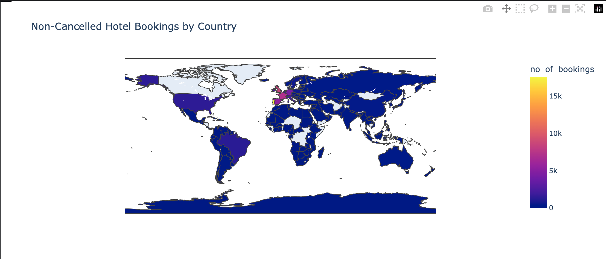
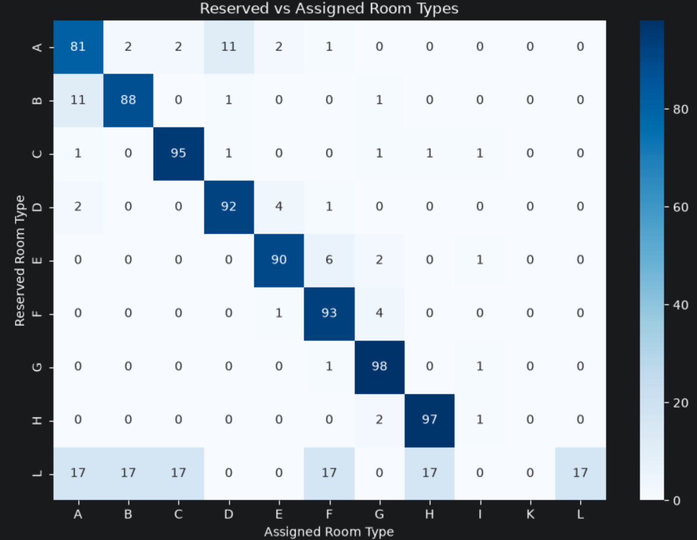
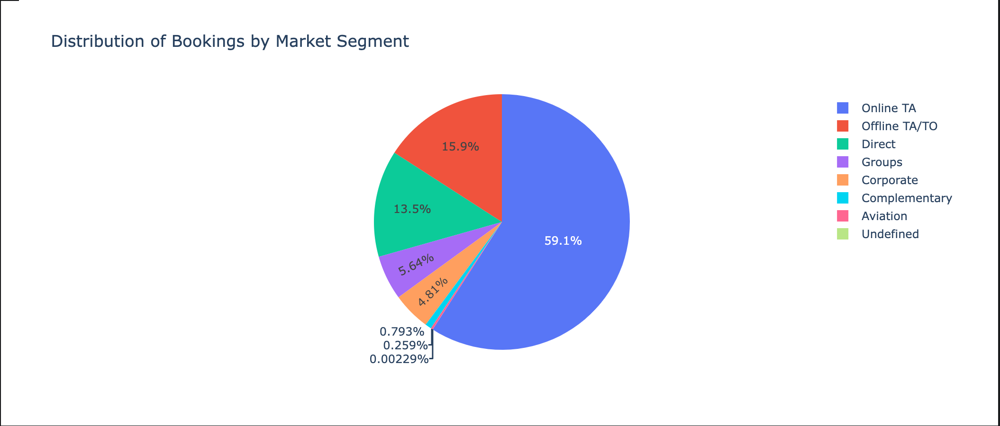
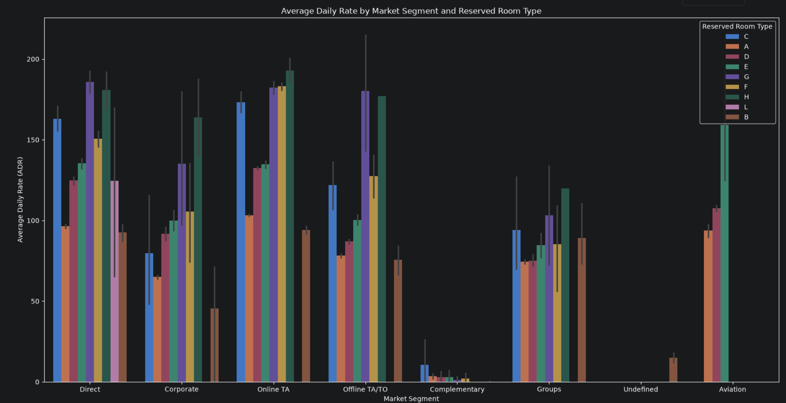
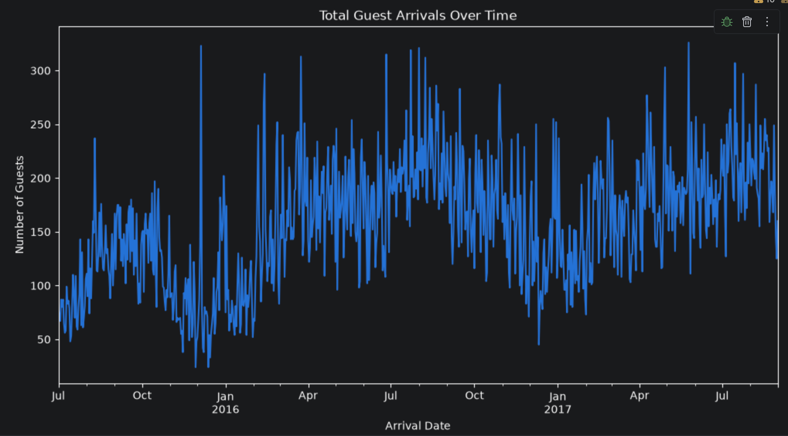
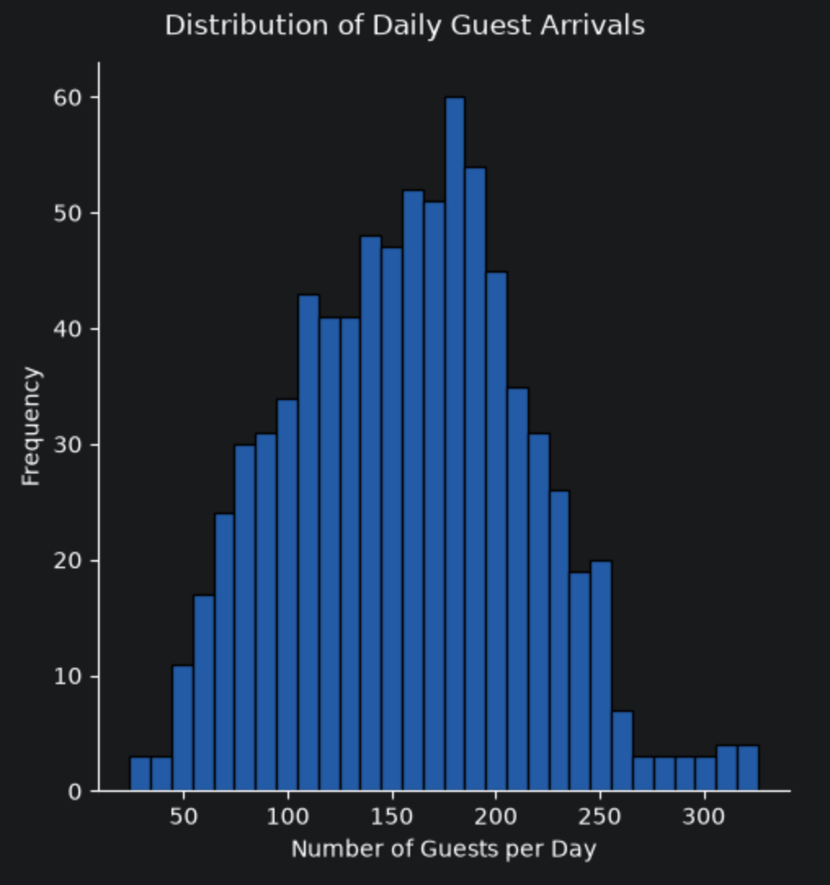
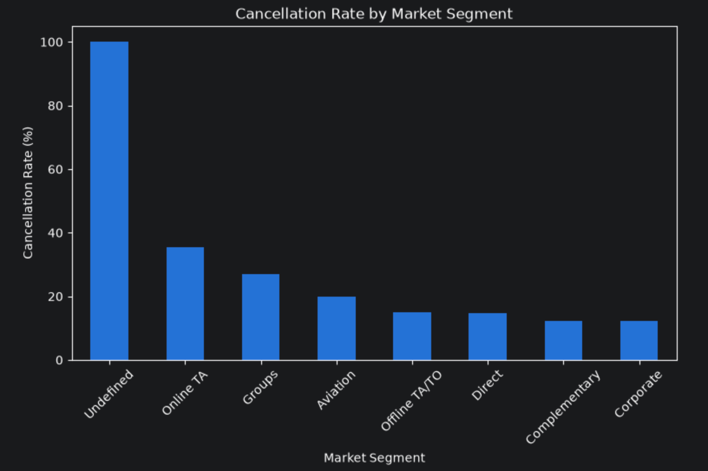

# hotel-booking-data-analysis

## Project Overview
 
This project explores hotel booking data using Python, with a focus on booking patterns, guest origins, room assignments, market segments, pricing, arrival trends, and cancellations.
 
The analysis combines data cleaning, exploratory data analysis (EDA), descriptive statistics, data visualisation, and grouped analysis to investigate both customer behaviour and operational patterns in hotel bookings.
 
## Objectives
 
The analysis focuses on the following questions:
 
- Where do non-cancelled bookings come from?
- How often does the assigned room type match the reserved room type?
- Which market segments generate the most bookings?
- How does the Average Daily Rate (ADR) vary across market segments and room types?
- How does guest arrival volume change over time?
- What does the distribution of daily guest arrivals look like?
- Which market segments have the highest cancellation rates?
 
## Data Cleaning
 
Before performing the analysis, the dataset was cleaned by:
 
- Identifying and removing bookings with zero adults, children, and babies
- Identifying and removing duplicate records
- Creating an independent cleaned DataFrame for further analysis
- Converting arrival-date components into a proper datetime variable
- Creating a `total_guests` variable by combining adults, children, and babies
 
## Exploratory Data Analysis
 
### 1. Descriptive Analysis
 
Descriptive statistics were calculated for:
 
- `lead_time`
- `total_of_special_requests`
- `adr`
 
The 90th to 100th percentiles were also examined to explore the upper tails of these variables and identify unusually high values or potential outliers.
 
### 2. Where Do the Bookings Come From?
 
Non-cancelled bookings were grouped by country to examine their geographical distribution.
 
A choropleth map provides a visual representation of booking volume across countries, while the ten countries with the largest numbers of non-cancelled bookings are also identified.
 

 
The analysis additionally calculates each country's percentage contribution to all non-cancelled bookings.
 
### 3. Reserved vs Assigned Room Types
 
Reserved and assigned room types were compared using a cross-tabulation.
 
The analysis calculates:
 
- The distribution of assigned room types for each reserved room type
- The percentage of bookings where the assigned room matched the reserved room
- The percentage of bookings where a different room type was assigned
 
A row-normalised heatmap visualises these relationships.
 

 
### 4. Bookings by Market Segment
 
The distribution of bookings across market segments was analysed to determine which booking channel contributes the largest share of reservations.
 

 
The percentage contribution of each market segment is calculated in addition to the raw booking counts.
 
### 5. Average Daily Rate by Market Segment and Room Type
 
Average Daily Rate (ADR) was compared across combinations of market segment and reserved room type.
 
For each combination, the analysis calculates:
 
- Number of bookings
- Average ADR
- Median ADR
 

 
This provides insight into how hotel pricing differs across booking channels and room categories.
 
### 6. Guest Arrivals Over Time
 
Arrival-date information was converted into a proper datetime variable, and the total number of arriving guests was calculated for each non-cancelled booking.
 
Bookings were then grouped by arrival date to calculate total daily guest volume.
 

 
The analysis also identifies the busiest and quietest arrival dates in the dataset.
 
### 7. Distribution of Daily Guest Arrivals
 
The distribution of daily guest volumes was examined using a histogram.
 

 
Summary statistics were calculated for daily arrival volumes, including:
 
- Mean
- Median
- Standard deviation
- Minimum
- Maximum
 
### 8. Cancellation Rates by Market Segment
 
Cancellation rates were calculated for each market segment by taking the proportion of bookings where `is_canceled = 1`.
 

 
The comparison highlights differences in cancellation behaviour across booking channels.
 
## Key Findings
 
After running the complete analysis, the main findings can be summarised as:
 
- **Booking origin:** PRT contributes the largest share of non-cancelled bookings, accounting for **27.98%**.
- **Room assignments:** **85.11%** of bookings receive the same room type that was originally reserved, while **14.89%** receive a different room type.
- **Market segments:** **Online TA** is the largest booking segment, accounting for **59.10%** of all bookings.
- **Pricing:** ADR varies across both market segments and reserved room types, with the highest average ADR observed for **Online TA / Room Type H**.
- **Guest arrivals:** The busiest arrival date is **25 May 2017**, with **326 guests**, compared with **24 guests** on the quietest arrival date.
- **Daily arrival volume:** Both the mean and median daily arrival volume are **158 guests**, indicating that the centre of the daily arrival distribution is consistent across these two measures.
- **Cancellations:** Excluding the `Undefined` category, **Online TA** has the highest observed cancellation rate at approximately **36%**, followed by **Groups** at approximately **27%**.
 
These findings describe relationships observed within the dataset and should not be interpreted as evidence of causal relationships.
 
## Tools & Technologies
 
- Python
- Pandas
- NumPy
- Matplotlib
- Seaborn
- Plotly
- Jupyter Notebook
 
## Skills Demonstrated
 
- Data cleaning and validation
- Duplicate detection and removal
- Pandas grouping and aggregation
- Cross-tabulation and normalisation
- Descriptive statistics
- Quantile analysis
- Datetime manipulation
- Categorical data analysis
- Geographical data visualisation
- Interactive visualisation with Plotly
- Time-series aggregation
- Distribution analysis
- Cancellation-rate analysis
 

 
## Data Access
 
The dataset is not included directly in this repository.
 
To reproduce the analysis, download `hotel_bookings.csv` and place it inside a `data` directory:
 
```text
data/
└── hotel_bookings.csv
```
 
The notebook reads the dataset using:
 
```python
df = pd.read_csv('data/hotel_bookings.csv')
```
 
## Installation
 
Install the required dependencies using:
 
```bash
pip install -r requirements.txt
```
 
The main external Python libraries used in this project are:
 
```text
pandas
numpy
matplotlib
seaborn
plotly
chart-studio
```
 
## Running the Project
 
1. Clone or download this repository.
2. Download the hotel booking dataset.
3. Createhildren, and zero babies are excluded from the analysis.
- Duplicate booking records are removed before the exploratory analysis.
- Country-level analysis is restricted to non-cancelled bookings.
- Guest arrival analysis is also restricted to non-cancelled bookings, since cancelled reservations do not represent actual arrivals.
- ADR refers to the Average Daily Rate recorded for each booking.
- Daily guest volume is calculated as the sum of adults, children, and babies associated with non-cancelled bookings for each arrival date.
- Cancellation rates are calculated as the percentage of bookings marked as cancelled within each market segment.
- The analysis is descriptive and does not establish causal relationships.
One thing I'd still change

For your requirements.txt, use:

Plain Text
pandas
numpy
matplotlib
seaborn
plotly
chart-studio
